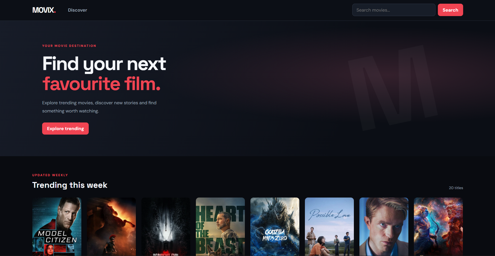
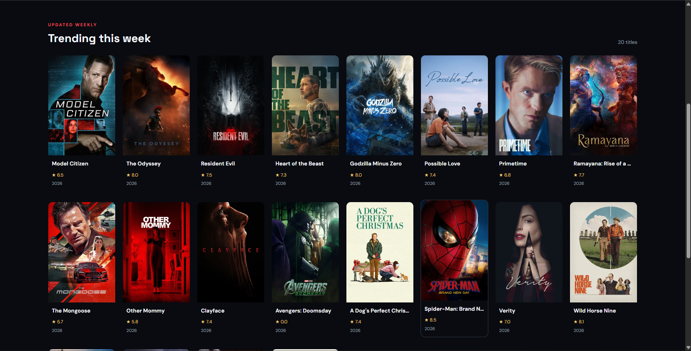

# Movix — Movie Discovery App

A responsive movie discovery web application built with React and powered by The Movie Database (TMDB) API. Explore trending movies, search titles and discover movie details through a clean, responsive interface.

## Features

- Discover weekly trending movies
- Search movies by title
- Browse movie posters, release years and ratings
- View movie descriptions and genres
- Responsive desktop and mobile layout
- Loading indicators and API error handling
- Live movie data from TMDB

## Technology Stack

| Component | Technology |
|---|---|
| Frontend | React 18 |
| Language | JavaScript |
| Styling | CSS |
| Movie data | TMDB API |
| Package manager | npm |

## Getting Started

### Prerequisites

- Node.js 18 or later
- npm
- TMDB API key

### 1. Clone the repository

```bash
git clone https://github.com/ashishjha2910/Movix-Netflix-Clone.git
cd Movix-Netflix-Clone
```

### 2. Install dependencies

```bash
npm install
```

### 3. Configure the TMDB API

Create an API key through your [TMDB account settings](https://www.themoviedb.org/settings/api).

Create a `.env.local` file in the project root:

```env
REACT_APP_TMDB_API_KEY=your_actual_api_key
```

Keep your API key private. The `.env.local` file should not be committed to GitHub.

### 4. Start the development server

```bash
npm start
```

Open:

**http://localhost:3000**

### 5. Create a production build

```bash
npm run build
```

The optimized production files are generated in the `build/` directory.

## Project Structure

```text
Movix-Netflix-Clone/
├── public/
├── src/
│   ├── components/
│   │   └── MovieCard.js
│   ├── services/
│   │   └── tmdb.js
│   ├── App.js
│   ├── App.css
│   └── index.js
├── .env.example
├── .gitignore
├── package.json
├── package-lock.json
└── README.md
```

## API and Attribution

Movie information and images are provided by [The Movie Database (TMDB)](https://www.themoviedb.org/).

This product uses the TMDB API but is not endorsed or certified by TMDB.

## Author

**Ashish Kumar**

- GitHub: [ashishjha2910](https://github.com/ashishjha2910)

---

Feedback and suggestions are welcome through GitHub Issues.

## Screenshots

### Movix Application




